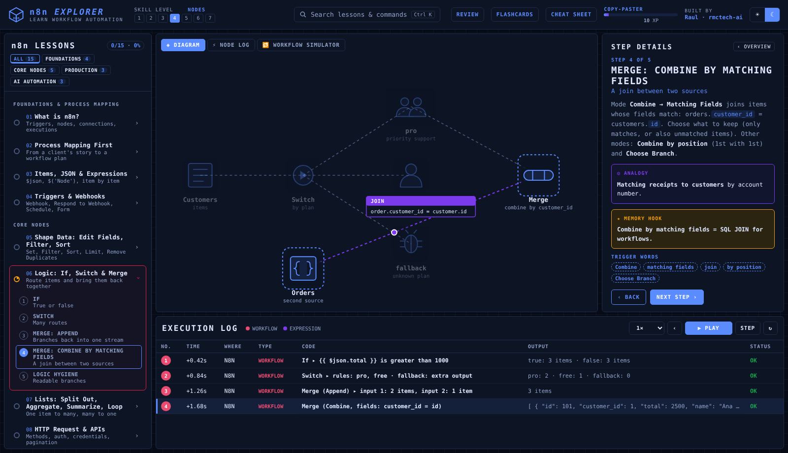

# 🔁 n8n Explorer — Learn workflow automation and AI agents with n8n

An interactive, step-by-step course on **n8n** for AI Automation Specialists: how to **map a business process** before building, how data flows as **items**, every **core node** you use daily (triggers, Edit Fields, Filter, If, Switch, Merge, Split Out, Aggregate, HTTP Request, Code), production habits (error handling, retries, sub-workflows, Save vs Publish in n8n 2.x, security and self-hosting on AWS), and **AI automation** with the AI Agent node, structured output, tools, RAG and human-in-the-loop. Every lesson animates how items move through a workflow, with analogies, memory hooks, trigger words, quizzes, and a **Workflow Simulator** lab that runs your YAML workflows like n8n does.

> Created by **Raul** ([@rmctech-ai](https://github.com/rmctech-ai)) · Freelance AI Automation Specialist on the path to Cloud Security.
> Part of the Explorer series: [Linux Explorer](https://github.com/rmctech-ai/linux-explorer) · [Python Explorer](https://github.com/rmctech-ai/python-explorer) · [IAM Explorer](https://github.com/rmctech-ai/iam-explorer) · [VPC Explorer](https://github.com/rmctech-ai/vpc-explorer) · [IaC Explorer](https://github.com/rmctech-ai/iac-explorer) · [Serverless Explorer](https://github.com/rmctech-ai/serverless-explorer) · [CI/CD Explorer](https://github.com/rmctech-ai/cicd-explorer) · [Cloud Security Explorer](https://github.com/rmctech-ai/cloudsecurity-explorer) · [Well-Architected Explorer](https://github.com/rmctech-ai/wellarchitected-explorer) · [Security Journey Explorer](https://github.com/rmctech-ai/aws-security-journey) · [Claude Code Explorer](https://github.com/rmctech-ai/claudecode-explorer) · [SAA Explorer](https://github.com/rmctech-ai/saa-explorer).
> 🏠 Part of **[Raul's Cloud Learning Hub](https://rmctech-ai.github.io/)** · Live course: https://rmctech-ai.github.io/N8N-Explorer/
> The Explorer course format is inspired by [Protocol Explorer](https://protocol-explorer-alpha.vercel.app/) by Dilum Sanjaya. All lessons, labs and study tools are my own work.



---

## ▶ Run it

No build step. Plain HTML/CSS/JS.

```bash
python3 -m http.server 8000     # then open http://localhost:8000
```

### Publish on GitHub Pages
```bash
git init && git add . && git commit -m "n8n Explorer"
git branch -M main
git remote add origin https://github.com/rmctech-ai/N8N-Explorer.git
git push -u origin main
```
GitHub → **Settings → Pages → Deploy from a branch → `main` / root → Save** → `https://rmctech-ai.github.io/N8N-Explorer/`

---

## 🧭 How to use it

| Area | What it does |
|---|---|
| **Lessons** (left) | 15 lessons grouped by track. Click to expand steps. Dots show progress. |
| **Diagram** tab | Animated scene for every step. |
| **⚡ NODE LOG** tab | Types out real commands/code for the step with realistic output. |
| **🔁 WORKFLOW SIMULATOR** tab | **Workflow Simulator**: describe a workflow in YAML (nodes with a name, type and settings, plus connections like `If:true -> Next` or `A -> Merge:2`) and press EXECUTE. The simulator runs it the way n8n does: items flow node by node, `{{ $json… }}` expressions are evaluated per item, If/Switch route items, Merge waits for its inputs, Code nodes run real JavaScript, HTTP Request nodes call mock APIs (shop, CRM with auth, Slack, mail), errors stop the run or go to an error output, sub-workflows run through an Execute Workflow Trigger, and an AI Agent node returns deterministic structured output so every challenge is checkable. |
| **Step Details** (right) | Explanation, **Analogy**, **Memory Hook**, **Trigger Words**, real-world notes, warnings. |
| **Execution Log** (bottom) | Log of every command so far with type, output and status. |
| **XP & levels** | Earn XP for steps, lessons, quizzes and challenges. Saved in your browser. |
| **Cheat Sheet** | Master hooks + key syntax for every lesson (also [`CHEATSHEET.md`](CHEATSHEET.md)). |

**Keyboard:** `→` / `←` steps · `Space` play · `Ctrl+K` search · `Esc` close.

---

## 📚 Curriculum (15 lessons · 75 steps · 60 quiz questions · 15 hands-on challenges)

| # | Lesson | Track | You'll learn |
|---|---|---|---|
| 01 | What is n8n? ⚑ | FOUNDATIONS | Triggers, nodes, connections, executions |
| 02 | Process Mapping First ⚑ | FOUNDATIONS | From a client's story to a workflow plan |
| 03 | Items, JSON & Expressions ⚑ | FOUNDATIONS | $json, $('Node'), item by item |
| 04 | Triggers & Webhooks ⚑ | FOUNDATIONS | Webhook, Respond to Webhook, Schedule, Form |
| 05 | Shape Data: Edit Fields, Filter, Sort ⚑ | CORE NODES | Set, Filter, Sort, Limit, Remove Duplicates |
| 06 | Logic: If, Switch & Merge ⚑ | CORE NODES | Route items and bring them back together |
| 07 | Lists: Split Out, Aggregate, Summarize, Loop ⚑ | CORE NODES | One item to many, many to one |
| 08 | HTTP Request & APIs ⚑ | CORE NODES | Methods, auth, credentials, pagination |
| 09 | The Code Node ⚑ | CORE NODES | JavaScript (and Python) when nodes aren't enough |
| 10 | Error Handling & Reliability ⚑ | PRODUCTION | Retry, error outputs, Error Trigger, idempotency |
| 11 | Sub-workflows, Versions & Publishing ⚑ | PRODUCTION | Reusable modules and safe releases |
| 12 | Security & Self-Hosting on AWS ⚑ | PRODUCTION | Webhook auth, credentials, Docker, queue mode |
| 13 | AI Agents in n8n ⚑ | AI AUTOMATION | Chat model, memory, tools, structured output |
| 14 | RAG & Document Workflows ⚑ | AI AUTOMATION | Chunk, embed, store, retrieve, answer |
| 15 | Capstone: AI Lead Intake Pipeline ⚑ | AI AUTOMATION | Map, build, secure, sell |

⚑ = has a hands-on challenge.

## 🎯 Study plan & capstone

- **Week 1:** Lessons 1–4 (n8n basics, process mapping, items & expressions, triggers). Map one real client process on paper.
- **Week 2:** Lessons 5–9 (core nodes: shaping data, logic, lists, HTTP & APIs, Code). Solve every simulator challenge.
- **Week 3:** Lessons 10–15 (errors, sub-workflows & publishing, security & self-hosting, AI agents, RAG, the capstone).

**Capstone:** Rebuild lesson 15's lead-intake pipeline in your own n8n instance (webhook → validate → AI classify → Switch → CRM → Slack → respond), with an error workflow and header auth on the webhook. Export the workflow JSON (without credentials) and the process map to a GitHub repo, and record a 2-minute walkthrough for your portfolio.

## License
MIT © 2026 Raul (rmctech-ai)
